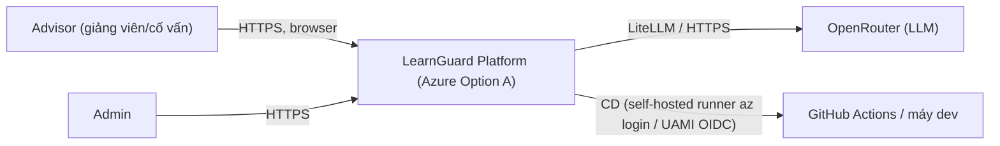
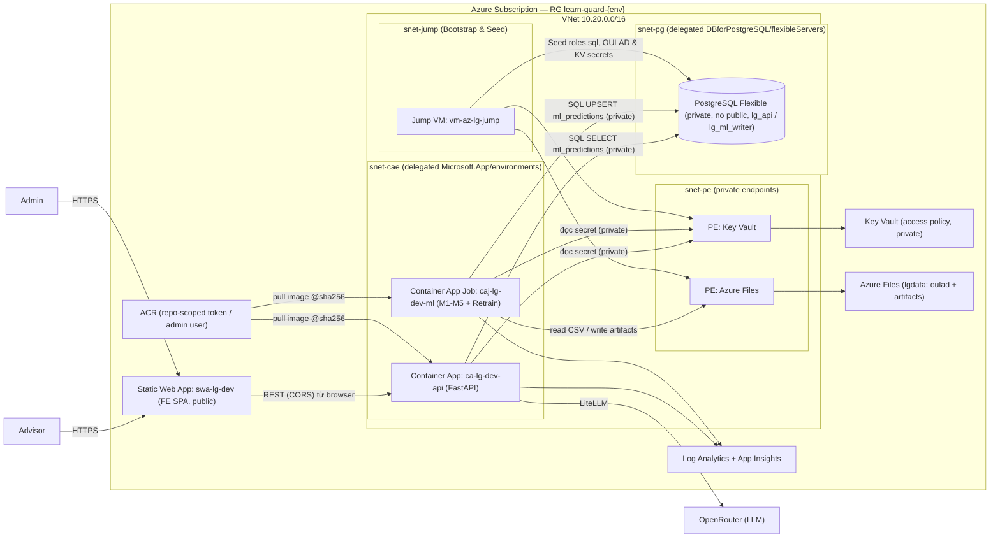
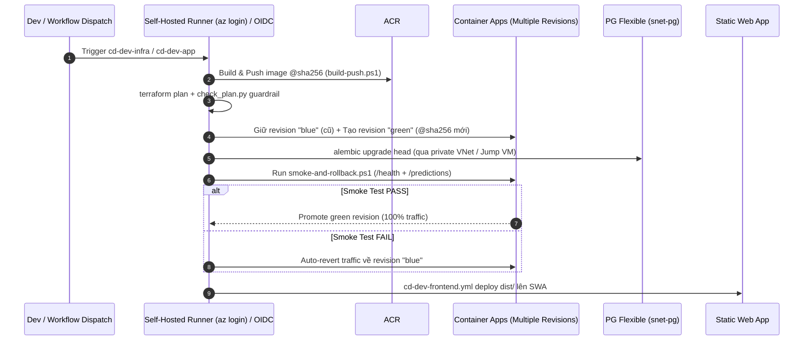
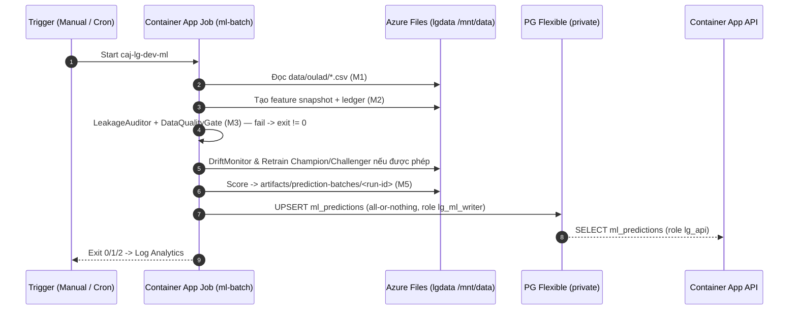

# LearnGuard — Active Cloud Option A: Azure PaaS Target Architecture (v2)

> **Phiên bản:** 2.1 (2026-11-23)
> **Trạng thái:** **Accepted — Active Cloud Option A (Azure PaaS)**
> **Quan hệ Dual-Cloud:** Hoạt động song song như **Option A** bên cạnh **Option B ([DigitalOcean VM v3](digitalocean-target-architecture.md))** theo chiến lược **Cloud-Portable Dual-Option (Deploy-Where-Available)** ([`dual-cloud-strategy.md`](dual-cloud-strategy.md)). Operator chọn triển khai lên Azure **hoặc** DigitalOcean tùy credit/tài khoản hiện có — không cần chạy hay trả phí đồng thời cả hai cloud.
> **Tham chiếu:** [ADR-0001](adr/0001-compute-container-apps.md) · [ADR-0002](adr/0002-frontend-static-web-apps.md) · [ADR-0003](adr/0003-data-postgresql-flexible.md) · [ADR-0004](adr/0004-secrets-dataplane-auth.md) · [ADR-0005](adr/0005-iac-terraform.md) · [ADR-0006](adr/0006-cicd-github-actions-oidc.md) · [ADR-0007](adr/0007-ml-storage-batch-observability.md) · [Azure Permissions Report](../04-devops/azure-permissions-report.md) · [Sơ đồ SVG Tương tác](diagrams/cloud-architecture.html)

---

## 1. Mục tiêu & Ràng buộc thực tế (Option A — Azure PaaS)

- **Lựa chọn Managed PaaS "like-production" tối đa trong giới hạn quyền `FSO-SandboxOps`:**
  - **CÓ** `Microsoft.Network/*` (đã xác minh ngày 2026-11-04 trong [`azure-permissions-report.md`](../04-devops/azure-permissions-report.md)).
  - **KHÔNG** role-assignment (`Microsoft.Authorization/*/Write+Delete`) và **KHÔNG** ghi AAD (`microsoft.aadiam/*/write` — không tự tạo service principal).
  - **Tuân thủ Azure Policy (`FSO-SZ`):** Storage & Key Vault bắt buộc tắt public network access; mọi subnet bắt buộc gắn NSG ngay khi tạo; tag governance chuẩn chữ hoa (`AZURE_CONSTRAINTS.md`).
- **Nguyên tắc phân lớp:**
  - **Data plane private:** PostgreSQL Flexible (`snet-pg`), Key Vault (`snet-pe` Private Endpoint), Azure Files (`lgdata` + Private Endpoint / Storage Firewall), Jump VM (`snet-jump`).
  - **App ingress public:** Static Web App (browser gọi REST API trực tiếp qua CORS) và Container App API (public ingress + CORS + IP restriction).
  - **Compute VNet-integrated:** Container Apps Environment (`snet-cae`) để API và ML Batch Job đi outbound vào private endpoints.
- **Tiêu chuẩn Engineering dùng chung:** IaC = Terraform (`infra/env/dev/`, `infra/modules/*`), immutable image theo digest (`@sha256` trên ACR), blue/green Container App revisions + rollback, least-privilege 2 DB roles (`lg_api`, `lg_ml_writer`), và cùng bộ Dockerfiles (`deploy/docker/`) + MLOps engine (`deploy/ml/`) với Option B.

---

## 2. C4 — Level 1 (System Context)

---

## 3. C4 — Level 2 (Containers & Private Networking trên Azure)

> [!NOTE]
> - Static Web App là static host nên browser gọi API trực tiếp qua CORS; do đó `ca-lg-dev-api` giữ external ingress + CORS hạn chế origin (`CORS_ORIGINS = https://${module.frontend.default_host_name}`). App Gateway (WAF) có thể bật ở Phase 2 nhưng bị hoãn vì chi phí (~`$180–320/tháng`) và không thay thế auth ứng dụng.
> - Để bật tính năng `/evaluations` và `/predictions/.../activity` đầy đủ trên Option A tương đương Option B, cần mount thêm `Azure Files` (`lgdata`) Read-Only vào `ca-lg-dev-api` (`EVALUATIONS_DIR=/mnt/data/artifacts/evaluations`, `OULAD_DATA_DIR=/mnt/data/oulad`) trong `infra/env/dev/apps.tf`.

---

## 4. Thành phần Azure ↔ Terraform Modules

| Thành phần | Azure Resource | Module / File trong Repo | Ghi chú |
| :--- | :--- | :--- | :--- |
| **Network** | `azurerm_virtual_network` + Subnets + NSG (ARM template cho delegated subnets) | `infra/modules/network/` | 4 subnets: `snet-cae`, `snet-pg`, `snet-pe`, `snet-jump` |
| **FE** | `azurerm_static_web_app` (`swa-lg-dev`) | `infra/modules/frontend/` | Public endpoint, `staticwebapp.config.json` SPA fallback |
| **Compute Env** | `azurerm_container_app_environment` (`cae-lg-dev`) | `infra/modules/compute/` | VNet-integrated (`infrastructure_subnet_id = snet-cae`) |
| **API & ML Batch** | `azurerm_container_app` (`ca-lg-dev-api`) + `azurerm_container_app_job` (`caj-lg-dev-ml`) | `infra/env/dev/apps.tf` | API external ingress + revision mode `Multiple`; Job không ingress |
| **DB** | `azurerm_postgresql_flexible_server` + delegated `snet-pg` | `infra/modules/data/` | `public_network_access_enabled=false`, TLS bắt buộc, 2 roles (`lg_api`, `lg_ml_writer`) |
| **Files** | `azurerm_storage_account` + `azurerm_storage_share` (`lgdata`) + Private Endpoint | `infra/modules/storage/` | Mount `/mnt/data` (`oulad/` + `artifacts/` + `scripts/`) |
| **Secret** | `azurerm_key_vault` + `private_endpoint` + access policy | `infra/modules/security/` | Access policy theo Managed Identity object-id (KHÔNG dùng RBAC) |
| **Image** | `azurerm_container_registry` (`acrdev*`) | `infra/modules/registry/` | Build qua `deploy/docker/build-push.ps1` + ghim `@sha256` |
| **Jump Access** | `azurerm_linux_virtual_machine` (`vm-az-lg-jump`) | `infra/modules/jump/` | Đứng trong `snet-jump` để nạp `roles.sql`, OULAD CSVs và KV secrets |
| **Observability** | `azurerm_log_analytics_workspace` + `azurerm_application_insights` | `infra/modules/observability/` | Log/telemetry cho API & Job |
| **Bootstrap State** | Storage Account riêng (`learn-guard-tfstate`) | `infra/bootstrap/` | Root riêng theo ADR-0005; xem `AZURE_CONSTRAINTS.md` về chính sách public network |
| **CD Guardrail** | `check_plan.py` chặn `azurerm_role_*` / `azurerm_policy_*` | `scripts/guardrails/check_plan.py` | Bắt buộc pass trước khi `terraform apply` |

---

## 5. Sequence Diagrams (Option A)

### 5.1. Deploy Blue/Green + Auto-Rollback (`cd-dev-app.yml`)

### 5.2. Batch Scoring & Retraining (`caj-lg-dev-ml`)

---

## 6. Rủi ro & Điểm Cần Hoàn thiện trên Option A

1. **App Authentication (`Q-AUTH`, `G-01`) — Rủi ro Chung của App Core:** `BE-MLOPS/api/auth.py` hiện vẫn đang stub (`NotImplementedError`), nên việc bảo vệ API public trên Option A trước khi đóng `BE-08`/`BE-09` phải dựa vào IP restriction/CORS. Xem chi tiết tại [`production-readiness-gap.md`](production-readiness-gap.md) và [`threat-model.md`](threat-model.md).
2. **CD Identity trên GitHub-Hosted Runner (`Q-CI-IDENTITY`, `Q-RBAC`):** Đường chính không cần Admin hiện là self-hosted runner tái dùng `az login` (`cd-dev-infra.yml`, `cd-dev-app.yml`). Nếu muốn chạy `cd-dev-infra-hosted.yml` hoàn toàn trên GitHub-hosted runner bằng OIDC + UAMI, gửi ticket [`../../runbooks/admin-requests.md`](../../runbooks/admin-requests.md) cho Tenant Admin.
3. **Storage & Key Vault Private Policy (`AZURE_CONSTRAINTS.md`):** Chính sách `FSO-SZ` chặn truy cập public vào Storage/KV; vì vậy thao tác seed secret, nạp dataset OULAD và chạy remote Terraform state từ ngoài VNet phải thực hiện thông qua Jump VM (`vm-az-lg-jump`) hoặc runner nằm trong VNet.
4. **Mount Shared Artifacts cho `ca-lg-dev-api`:** Để giữ 100% parity tính năng `/evaluations` và `/predictions/.../activity` như Option B, cần khai báo thêm volume mount `Azure Files` (`lgdata`) vào `ca-lg-dev-api` trong `infra/env/dev/apps.tf`.
5. **Tài liệu Vận hành Option A:** Xem [`../../runbooks/deploy-dev.md`](../../runbooks/deploy-dev.md), [`../../runbooks/cd-setup.md`](../../runbooks/cd-setup.md), [`../../runbooks/admin-requests.md`](../../runbooks/admin-requests.md), và chỉ mục [`../04-devops/runbooks-index.md`](../04-devops/runbooks-index.md).
