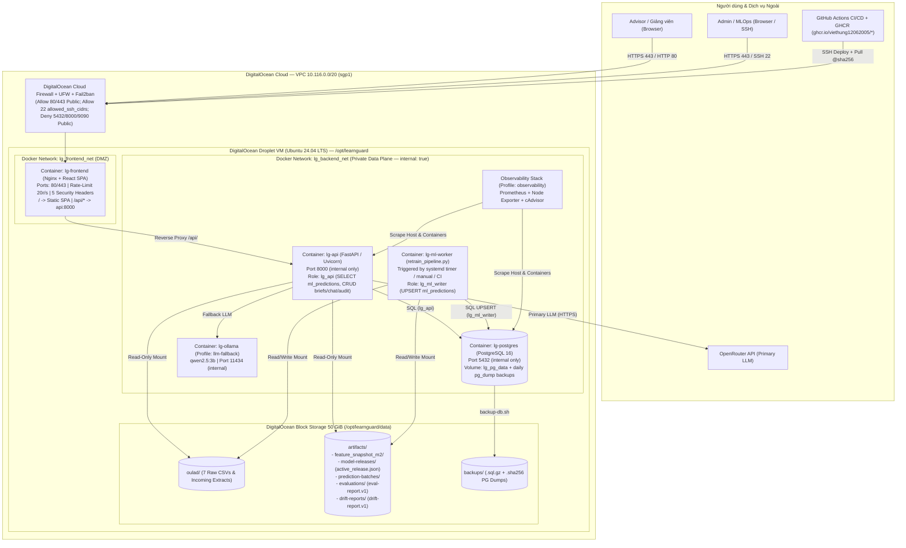
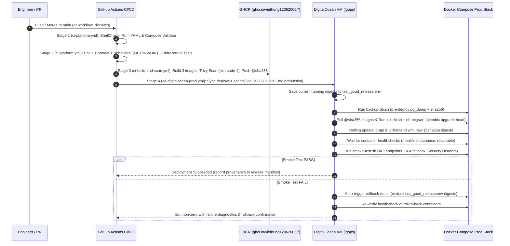
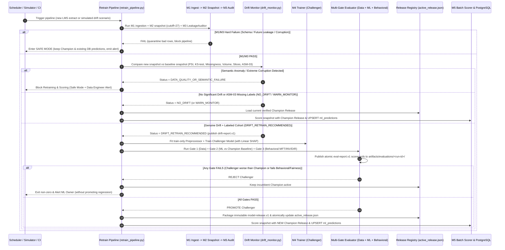

# LearnGuard — Active Cloud Option B: DigitalOcean VM & CI/CD Target Architecture (v3)

> **Phiên bản:** 3.1 (2026-11-23)
> **Trạng thái:** **Accepted — Active Cloud Option B (DigitalOcean VM)**
> **Quan hệ Dual-Cloud:** Hoạt động song song như **Option B** bên cạnh **Option A ([Azure PaaS v2](azure-target-architecture.md))** theo chiến lược **Cloud-Portable Dual-Option (Deploy-Where-Available)** ([`dual-cloud-strategy.md`](dual-cloud-strategy.md)). Operator triển khai lên DigitalOcean **hoặc** Azure tùy theo credit/tài khoản khả dụng tại thời điểm vận hành — không cần chạy hay trả phí đồng thời cả hai cloud.
> **Tham chiếu ADR:** [ADR-0008](adr/0008-cloud-migration-digitalocean-vm.md) · [ADR-0009](adr/0009-cicd-pipeline-digitalocean-ghcr.md) · [ADR-0010](adr/0010-drift-detection-and-continual-retraining-pipeline.md)

---

## 1. Mục tiêu Kiến trúc & Ràng buộc Vận hành (Option B — DigitalOcean VM)

1. **Production-Like trên DigitalOcean Droplet VM:**
   - Triển khai toàn bộ hệ thống LearnGuard trên **DigitalOcean Droplet** (Ubuntu 24.04 LTS, mặc định `s-4vcpu-8gb` hoặc tối thiểu `s-2vcpu-4gb`) nằm trong **DigitalOcean VPC (`10.116.0.0/20`)**, được bảo vệ bởi **DigitalOcean Cloud Firewall** + host `ufw` + `fail2ban`.
   - Phân tách mạng container trong `deploy/digitalocean/docker-compose.prod.yml` thành 2 vùng cô lập:
     - `lg_frontend_net` (DMZ): chứa `frontend` (Nginx) và `api` (FastAPI) (+ `ollama` nếu bật profile `llm-fallback`).
     - `lg_backend_net` (`internal: true` — Private Data Plane): chứa `api`, `postgres`, `ml-worker`, `ollama` (optional), `prometheus` / `node-exporter` / `cadvisor`. **PostgreSQL hoàn toàn không mở cổng `5432` ra ngoài host hay Internet.**
2. **Bảo mật Dữ liệu & Least-Privilege ở Tầng Database (Parity với Option A):**
   - Duy trì phân tách 2 role PostgreSQL riêng biệt thông qua `deploy/digitalocean/init-db.sh` & `deploy/db/roles.sql`:
     - `lg_ml_writer`: chỉ sở hữu và có quyền ghi/upsert trên bảng `ml_predictions`.
     - `lg_api`: chỉ có quyền `SELECT` trên `ml_predictions` và quyền CRUD trên các bảng nghiệp vụ backend (`users`, `briefs`, `decisions`, `llm_calls`, `audit_logs`, `chat_sessions`, `chat_messages`), tự động nhận quyền bảng mới do `db-migrate` (`alembic upgrade head`) tạo qua `ALTER DEFAULT PRIVILEGES`.
3. **CI/CD Tự động Hóa Đầu-Cuối trên GitHub-Hosted Runners & Rollback Tức thì:**
   - Mọi thay đổi đi qua GitHub Actions: `Lint & Guardrails → 6-Layer Testing (Unit + Contract + Behavioral + Drift Simulation) → Build Immutable Docker Images → Trivy Scan (exit-code: 1) → Push GHCR (@sha256 digest) → Deploy via SSH → DB Migration → E2E Smoke Test → Auto-Rollback on Failure (< 60s)`.
4. **Đóng Vòng lặp Telemetry, Phát hiện Drift & Continual Retraining:**
   - Chia sẻ Block Storage Volume `/opt/learnguard/data` (`oulad/` + `artifacts/`) giữa `ml-worker` (Read-Write) và `api` (Read-Only) để cố vấn và quản trị viên theo dõi trực tiếp Scorecard đánh giá (`GET /evaluations`) và hành vi 4 tuần (`GET /predictions/.../activity`) trên giao diện web.

---

## 2. Sơ đồ Kiến trúc C4 — Container & Network Topology trên DigitalOcean



---

## 3. Luồng Triển khai CI/CD & Tự động Rollback (Sequence Diagram)



---

## 4. Luồng Phát hiện Data Drift, Chẩn đoán & Continual Retraining (Sequence Diagram)

Tuân thủ chặt chẽ nguyên tắc của **Lecture 4 (Q19–Q22)** và **Lecture 5–6** (xem thêm [`drift-and-retraining-specification.md`](drift-and-retraining-specification.md) & [`../../runbooks/drift-and-retraining-runbook.md`](../../runbooks/drift-and-retraining-runbook.md)):
- Không tự động retrain mù quáng khi luồng dữ liệu bị lỗi schema hoặc lỗi ngữ nghĩa (semantic corruption) hoặc khi tuần 4 chưa có nhãn kết quả cuối kỳ (`ASM-03`).
- Chỉ promote mô hình Challenger khi vượt qua toàn bộ cổng kiểm định **Data Gate + ML Gate (Champion vs. Challenger, fail-closed) + Behavioral Gate (MFT/INV/DIR)**.



---

## 5. Cấu trúc Thư mục Chuẩn trên DigitalOcean VM (`/opt/learnguard`)

```text
/opt/learnguard/
├── deploy/
│   ├── digitalocean/
│   │   ├── docker-compose.prod.yml
│   │   ├── docker-compose.staging.yml
│   │   ├── .env                         # chmod 600 (KHÔNG commit)
│   │   ├── last_good_release.env        # tự động lưu trước mỗi lần deploy để rollback
│   │   ├── init-db.sh
│   │   └── prometheus.yml
│   ├── db/
│   │   └── roles.sql
│   ├── docker/
│   │   └── nginx.fe.conf
│   ├── ml/
│   │   ├── ml_pipeline.py
│   │   ├── drift_monitor.py
│   │   ├── behavioral_gate.py
│   │   ├── data_simulator.py
│   │   └── retrain_pipeline.py
│   └── releases/
│       ├── dev.yaml
│       └── prod.yaml                    # GitOps release manifest (@sha256 digests)
├── scripts/
│   ├── cd/
│   │   ├── deploy-do.sh
│   │   ├── smoke-test.sh
│   │   ├── rollback-do.sh
│   │   ├── backup-db.sh
│   │   └── restore-db.sh
│   └── do/
│       └── bootstrap-vm.sh
└── data/                                # Mounted from DO Block Storage Volume (50 GiB)
    ├── oulad/                           # 7 file CSV OULAD chuẩn
    ├── artifacts/
    │   ├── ingestion_m1/
    │   ├── feature_snapshot_m2/
    │   ├── preprocessing-runs/
    │   ├── model-runs/
    │   ├── model-releases/
    │   │   └── active_release.json      # Con trỏ release đang active + lịch sử rollback
    │   ├── prediction-batches/
    │   ├── evaluations/                 # API mount RO phục vụ GET /evaluations
    │   └── drift-reports/               # Báo cáo chẩn đoán drift (drift-report.v1)
    └── backups/                         # Bản sao lưu PostgreSQL định kỳ & trước deploy
```

> Xem hướng dẫn triển khai, vận hành và diễn tập khôi phục Option B tại [`../../runbooks/deploy-digitalocean.md`](../../runbooks/deploy-digitalocean.md), [`../../runbooks/drift-and-retraining-runbook.md`](../../runbooks/drift-and-retraining-runbook.md), [`../../runbooks/incident-and-rollback.md`](../../runbooks/incident-and-rollback.md), và chỉ mục tổng hợp [`../04-devops/runbooks-index.md`](../04-devops/runbooks-index.md).
