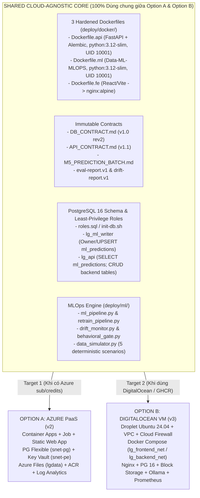
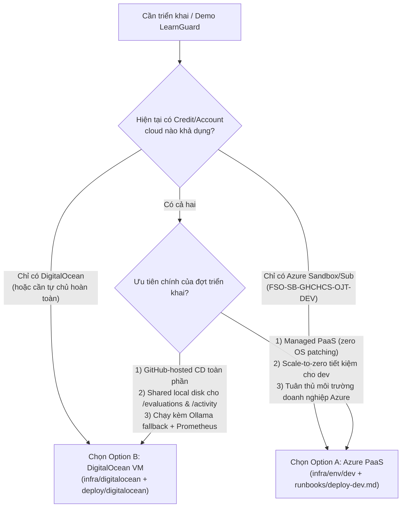

# Chiến lược Hạ tầng Dual-Cloud Di động (Cloud-Portable Dual-Option Strategy)

> **Phiên bản:** 1.0 (2026-11-23)
> **Trạng thái:** **Accepted** (Quản trị song song 2 đích triển khai hạng nhất: **Option A — Azure PaaS** & **Option B — DigitalOcean VM**)
> **Tham chiếu:** [`azure-target-architecture.md`](azure-target-architecture.md) · [`digitalocean-target-architecture.md`](digitalocean-target-architecture.md) · [`adr/0001..0007`](adr/0001-compute-container-apps.md) · [`adr/0008`](adr/0008-cloud-migration-digitalocean-vm.md) · [`../04-devops/runbooks-index.md`](../04-devops/runbooks-index.md)

---

## 1. Định nghĩa Chiến lược: Deploy-Where-Available (KHÔNG phải Active-Active Multi-Cloud)

Trong bối cảnh dự án LearnGuard (đội ngũ 4 thành viên, nguồn tài nguyên và credit cloud có thể thay đổi theo từng giai đoạn học phần/doanh nghiệp), khái niệm **"Dual-Cloud"** được thiết kế theo mô hình **Cloud-Portable Dual-Option Deployment (Deploy-Where-Available)**:

1. **Duy trì sẵn sàng cả hai hạ tầng đích trong `learnguard-platform`:**
   - **Active Cloud Option A — Azure PaaS (`v2`):** Terraform (`infra/modules/*`, `infra/env/dev/`), `cd-dev-*.yml`, `runbooks/deploy-dev.md`, `runbooks/cd-setup.md`, `runbooks/admin-requests.md`.
   - **Active Cloud Option B — DigitalOcean VM (`v3`):** Terraform (`infra/digitalocean/`), Docker Compose (`deploy/digitalocean/`), `cd-digitalocean-prod.yml`, `ci-build-and-scan.yml` (GHCR), `runbooks/deploy-digitalocean.md`.
2. **Tại một thời điểm, operator chỉ deploy lên MỘT cloud đang có credit/tài khoản khả dụng:**
   - **KHÔNG** yêu cầu chạy đồng thời active-active cả Azure lẫn DigitalOcean và **KHÔNG** bắt buộc phải trả chi phí cho cả hai cloud cùng lúc.
   - Không có bất kỳ thay đổi mã nguồn nào trong `BE-MLOPS`, `Data-ML-MLOPS`, hay `FE-MLOPS` khi chuyển đổi giữa Option A và Option B.

---

## 2. Lõi Phi Đám mây Dùng chung (Shared Cloud-Agnostic Core)

Sự di động (portability) giữa Option A và Option B đạt được bằng cách tách rạch ròi **Lõi Ứng dụng & Dữ liệu** khỏi **Lớp Hạ tầng Cloud**:

### Thành phần Lõi Dùng chung đã Kiểm chứng trong Repo
1. **3 Multi-Stage Dockerfiles (`deploy/docker/`):**
   - `Dockerfile.api`: build `BE-MLOPS` kèm `alembic`, chạy `uvicorn learnguard_backend.main:app --host 0.0.0.0 --port 8000` bằng non-root user `learnguard` (`UID 10001`).
   - `Dockerfile.ml`: build `Data-ML-MLOPS` với `OMP/OPENBLAS/MKL_NUM_THREADS=1`, non-root `UID 10001`, dữ liệu tại `/mnt/data/oulad` và `/mnt/data/artifacts`.
   - `Dockerfile.fe`: build `FE-MLOPS` bằng `node:22-alpine` (`VITE_BACKEND_API_URL`, `VITE_USE_MOCK=false`) sang `nginx:alpine`.
2. **PostgreSQL Least-Privilege Roles (`deploy/db/roles.sql` & `deploy/digitalocean/init-db.sh`):**
   - Dù chạy trên `Azure PostgreSQL Flexible Server` hay container `postgres:16-alpine` trong `lg_backend_net`, hai tài khoản `lg_ml_writer` và `lg_api` có ranh giới quyền y hệt nhau (chứng minh trong `BE-MLOPS/docs/DB_CONTRACT.md`).
3. **Hợp đồng Giao tiếp & Cổng Chất lượng:**
   - Mọi bản build đều phải vượt qua cùng bộ kiểm thử `tests/test_system_contracts.py`, `tests/test_behavioral_gate.py`, và `tests/test_drift_and_retraining.py`.
4. **Động cơ MLOps (`deploy/ml/retrain_pipeline.py`):**
   - Nhận cấu hình hoàn toàn qua biến môi trường chuẩn (`LEARNGUARD_PG_DSN`, `LEARNGUARD_DATA_DIR`, `LEARNGUARD_ARTIFACTS_DIR`, `LEARNGUARD_CUTOFF_DAY=27`), không hardcode SDK của Azure hay DigitalOcean.

---

## 3. So sánh Kiến trúc & Chi phí (Option A vs. Option B)

| Chiều So sánh | Option A — Azure PaaS (`v2`) | Option B — DigitalOcean VM (`v3`) |
| :--- | :--- | :--- |
| **Compute (API & ML Batch)** | `Azure Container App` (`ca-lg-dev-api`, `min_replicas=0..2`) + `Container App Job` (`caj-lg-dev-ml`, `2 vCPU / 4 GiB`, manual/cron). | `DigitalOcean Droplet` Ubuntu 24.04 (`s-4vcpu-8gb` mặc định trong `infra/digitalocean/variables.tf`, hoặc tối thiểu `s-2vcpu-4gb`) chạy `docker-compose.prod.yml`. |
| **Frontend & Routing** | `Azure Static Web Apps` (`swa-lg-dev`, `staticwebapp.config.json`) gọi trực tiếp Public API qua CORS. | Container `nginx:alpine` trong `lg_frontend_net` phục vụ SPA `dist/` + reverse proxy `/api/* → api:8000` (cùng origin, rate-limit `20r/s`, 5 security headers). |
| **Database** | `Azure PostgreSQL Flexible Server` (Burstable `B1ms` cho dev), delegated subnet `snet-pg`, private DNS, `public_network_access_enabled=false`, TLS bắt buộc. | Container `postgres:16-alpine` trong `lg_backend_net` (`internal: true`), hoàn toàn không bind cổng `5432` ra host; backup định kỳ + pre-deploy qua `backup-db.sh`. |
| **Shared Storage (OULAD & Artifacts)** | `Azure Storage Account` + `Azure Files` (`lgdata`, 16 GB) mount `/mnt/data` vào ML Job (cần cấu hình tương tự cho API nếu bật `/evaluations` & `/activity`). | `DigitalOcean Block Storage` 50 GiB (`ext4`, mount tại `/opt/learnguard/data`), `ml-worker` mount `rw`, `api` mount `ro` trực tiếp `oulad/` & `artifacts/evaluations/`. |
| **Secrets Management** | `Azure Key Vault` + Private Endpoint (`snet-pe`) + Access Policy (Managed Identity cho `api`/`job`/`jump` VM). | Host `.env` (`chmod 600`, không commit) trên Droplet + `GitHub Environment: production` secrets (`DO_HOST`, `DO_USER`, `DO_SSH_KEY`, `DO_PORT`, `GHCR_READ_TOKEN`). |
| **Container Registry** | `Azure Container Registry` (ACR Basic + repo-scoped token / admin user). | `GitHub Container Registry` (`ghcr.io/viethung12062005/*`) với immutable `@sha256` digests và Trivy scan (`exit-code: 1`). |
| **Network Isolation** | `VNet 10.20.0.0/16` (4 subnets: `snet-cae`, `snet-pg`, `snet-pe`, `snet-jump`) + NSG bắt buộc + Jump VM `vm-az-lg-jump`. | `DigitalOcean VPC 10.116.0.0/20` + Cloud Firewall + host `ufw`/`fail2ban` + 2 Docker networks (`lg_frontend_net` DMZ vs `lg_backend_net` internal). |
| **Observability** | `Log Analytics Workspace` + `Application Insights`. | `Prometheus` + `Node Exporter` + `cAdvisor` (profile `observability` trong `lg_backend_net`) + structured logs. |
| **Local LLM Fallback** | Phụ thuộc OpenRouter (hoặc cần cấu hình thêm container Ollama riêng). | Tích hợp sẵn container `ollama` (`qwen2.5:3b`, profile `llm-fallback`) trong `lg_backend_net`. |
| **CI/CD & Rollback** | CI GitHub-hosted; CD trên **self-hosted Windows runner** (`az login`) hoặc UAMI+OIDC (cần Admin); Blue/Green Container App revisions (`smoke-and-rollback.ps1`). | **100% GitHub-hosted runner** (`ci-platform.yml`, `ci-build-and-scan.yml`, `cd-digitalocean-prod.yml`, `mlops-drift-retrain.yml`); auto-rollback `< 60s` qua `last_good_release.env` + `rollback-do.sh`. |
| **Chi phí Ước tính (chỉ khi chạy cloud đó)** | **Dev (`eastasia`, `infra/README.md`):** ~`$30–39 / tháng` (PG B1ms `$13–15`, CA/Job `$1–5`, ACR `$5`, KV+PE `$8`, Storage `$1–2`, LA `$2–4`). **Prod (ước lượng nếu bật HA + AppGW + SWA Std):** tăng đáng kể (~`$200+ / tháng`, *cần xác minh bằng Azure Pricing Calculator*). | **Droplet `s-2vcpu-4gb`:** `$24 / tháng` + Volume 50 GB `$5 / tháng` + Backups `~$4.8 / tháng` ≈ **`$34 / tháng`**. **Droplet `s-4vcpu-8gb` (khuyến nghị `prod.yaml`):** `$48 / tháng` + Volume 50 GB `$5 / tháng` + Backups `~$9.6 / tháng` ≈ **`$63 / tháng`**. |

---

## 4. Đánh đổi Vận hành & Ma trận Tương đồng (Operational Trade-offs & Parity Matrix)

### 4.1. Đánh đổi Vận hành (Trade-offs)
- **Option A — Azure PaaS:**
  - *Điểm mạnh:* Không phải vá hệ điều hành (OS patching), không phải tự quản lý cluster/Docker daemon, PG Flexible có managed automated backup, Container App hỗ trợ `min_replicas=0` tiết kiệm cho dev và chia lưu lượng revision blue/green tự nhiên.
  - *Đánh đổi thực tế đã đo (`azure-permissions-report.md` & `AZURE_CONSTRAINTS.md`):* Subscription `FSO-SB-GHCHCS-OJT-DEV` (`FSO-SandboxOps`) **chặn** `Microsoft.Authorization/*/Write` và `aadiam/*/write`, kèm các Azure Policy `FSO-SZ` chặn public network trên Storage & Key Vault và bắt buộc NSG trên mọi subnet. Vì vậy: (1) CD tự động dùng GitHub-hosted OIDC cần ticket Admin (`admin-requests.md`), đường chính không cần Admin phải dùng self-hosted runner + `az login`; (2) Nạp DB/OULAD và đọc remote state phải đi qua Jump VM `vm-az-lg-jump` trong VNet; (3) SWA tách biệt khỏi Container App nên FE phải gọi API cross-origin (CORS) thay vì reverse proxy nội bộ.
- **Option B — DigitalOcean VM:**
  - *Điểm mạnh:* Chủ dự án có toàn quyền VPC/Firewall/VM không bị vướng Tenant Policy; CD chạy hoàn toàn trên GitHub-hosted runner qua SSH key riêng; chia sẻ đĩa `/opt/learnguard/data` tốc độ cao cho phép `api` đọc tức thì `eval-report.v1` (`/evaluations`) và `oulad/*.csv` (`/predictions/.../activity`) mà không phát sinh phí/độ trễ SMB/Azure Files; chạy sẵn stack `Prometheus` và `Ollama` fallback ngay trong mạng nội bộ `lg_backend_net`.
  - *Đánh đổi thực tế:* Mô hình Single-VM có điểm lỗi đơn (SPOF) ở tầng phần cứng VM và yêu cầu tự bảo trì bảo mật OS (`unattended-upgrades`, xoay log, Docker cleanup); đồng thời cần kiểm soát bộ nhớ (`s-4vcpu-8gb` hoặc swap) nếu chạy đồng thời M1 (`studentVle.csv` ~454 MB) và container Ollama `qwen2.5:3b`. Rủi ro SPOF được giảm thiểu bằng `backup-db.sh`, DO Automated Backups và Terraform IaC (`infra/digitalocean/`) dựng lại VM mới trong `< 15 phút`.

### 4.2. Ma trận Tương đồng Chức năng (Dual-Cloud Parity Matrix)

| Lớp Hệ thống | Option A (Azure PaaS) | Option B (DigitalOcean VM) | Trạng thái Parity |
| :--- | :--- | :--- | :--- |
| **API & ML Images** | Build từ `Dockerfile.api`, `Dockerfile.ml` (non-root UID 10001) → ACR `@sha256` | Build từ cùng `Dockerfile.api`, `Dockerfile.ml`, `Dockerfile.fe` → GHCR `@sha256` | ✅ **100% Identical Code** |
| **PostgreSQL Isolation** | `lg_ml_writer` / `lg_api` (nạp từ Jump VM qua `deploy/db/seed.sh` & `roles.sql`) | `lg_ml_writer` / `lg_api` (tự động idempotent qua `init-db.sh` & `roles.sql`) | ✅ **100% Parity** |
| **FE ↔ API Transport** | SWA public HTTPS → Container App API public ingress + CORS (`CORS_ORIGINS`) | Nginx public HTTPS/HTTP → reverse proxy nội bộ `/api/` → `api:8000` (cùng origin) | 🟡 **Different Topology, Same API Contract** |
| **Evaluations & Activity Storage** | Azure Files `lgdata` hiện mount cho `ml-batch`; cần mount thêm vào `ca-lg-dev-api` (`EVALUATIONS_DIR`, `OULAD_DATA_DIR`) | Block Storage `/opt/learnguard/data` đã mount `rw` cho `ml-worker` & `ro` cho `api` | 🟡 **Option B Complete; Option A cần mount cho API** |
| **Drift & Retraining Engine** | `ml_pipeline.py` / `retrain_pipeline.py` chạy trên `caj-lg-dev-ml` | `retrain_pipeline.py` chạy trên `ml-worker` (systemd timer `06:30 UTC` Thứ 2 / CI trigger) | ✅ **100% Parity** |
| **App Auth (M6 JWT/RBAC)** | Chưa enforce (`BE-MLOPS/api/auth.py` stub) — phải bù bằng IP restriction | Chưa enforce (`BE-MLOPS/api/auth.py` stub) — phải bù bằng Firewall/TLS trước public | 🔴 **Shared App Gap (Cần đóng ở `BE-08`/`FE-09`)** |
| **Supply Chain Scan (Trivy)** | Dùng chung pipeline build/scan hoặc ACR Tasks (hiện `build-push.ps1` chưa tích hợp Trivy tự động) | Tích hợp bắt buộc trong `ci-build-and-scan.yml` (`Trivy exit-code: 1`) | 🟡 **Option B Automated; Option A dùng chung image CI** |
| **Pre-Deploy DB Backup & Rollback** | Blue/green revision rollback (`smoke-and-rollback.ps1`); backup dựa vào PG Flexible snapshot | `backup-db.sh` tự động trước mọi deploy + `rollback-do.sh` (`< 60s`) + `retrain_pipeline.py --mode rollback` | ✅ **Both Have Automated Rollback** |

---

## 5. Cây Quyết định Chọn Cloud khi Triển khai (Selection Decision Tree)

---

## 6. Chuyển đổi & Khôi phục Chéo Cloud (Cross-Cloud Portability & Runbook Pointers)

Do cả hai option chia sẻ chung schema PostgreSQL và định dạng thư mục `oulad/` + `artifacts/`, việc chuyển môi trường đang chạy từ **Option A ↔ Option B** (ví dụ khi hết credit ở cloud này và chuyển sang cloud kia) chỉ gồm 4 bước chuẩn hóa:

1. **Provision hạ tầng đích mới** bằng Terraform của cloud đích:
   - Sang Option A: theo [`../../runbooks/deploy-dev.md`](../../runbooks/deploy-dev.md) và [`../../runbooks/cd-setup.md`](../../runbooks/cd-setup.md).
   - Sang Option B: theo [`../../runbooks/deploy-digitalocean.md`](../../runbooks/deploy-digitalocean.md).
2. **Xuất & Nạp dữ liệu (`PostgreSQL` + `OULAD/Artifacts`):**
   - Dump DB nguồn (`pg_dump` / `scripts/cd/backup-db.sh`) và restore vào DB đích (`restore-db.sh` hoặc qua Jump VM trên Azure), chạy lại idempotent `roles.sql` / `init-db.sh` để đảm bảo quyền `lg_api` và `lg_ml_writer`.
   - Đồng bộ cây `/opt/learnguard/data/{oulad,artifacts}` ↔ Azure Files `lgdata/{oulad,artifacts}` (giữ nguyên `active_release.json`, `model-releases/`, `evaluations/`, `drift-reports/`).
3. **Đẩy / Ghim cùng bộ Container Image Digest:**
   - Cùng commit SHA app (`BE-MLOPS`, `Data-ML-MLOPS`, `FE-MLOPS`) trong [`../../deploy/releases/prod.yaml`](../../deploy/releases/prod.yaml); push lên GHCR (Option B) hoặc ACR (Option A) và kiểm tra `smoke-test.sh` / `smoke-and-rollback.ps1`.
4. **Hạ tài nguyên cloud cũ (Decommission)** sau khi smoke test cloud mới đạt 100% để tránh phát sinh chi phí trùng lặp trên hai cloud.

> Xem danh mục đầy đủ mọi quy trình thao tác và ứng phó sự cố tại **[`04-devops/runbooks-index.md`](../04-devops/runbooks-index.md)**.
