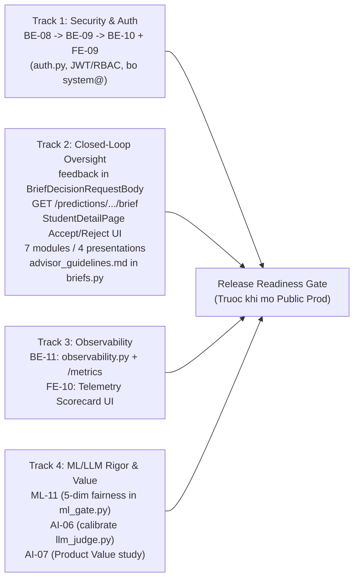

# Chiến lược Kỹ thuật Phần mềm & Bàn giao Hệ thống (Software Engineering & Delivery Strategy)

> **Phiên bản:** 1.0 (2026-11-23)
> **Phạm vi:** Toàn bộ hệ thống **LearnGuard** (4 kho mã nguồn: `learnguard-platform`, `Data-ML-MLOPS`, `BE-MLOPS`, `FE-MLOPS`) và 4 vai trò (`MLOPS`, `SWE1`, `SWE2`, `AIE`).
> **Tham chiếu:** [`../00-conventions.md`](../00-conventions.md) · [`../00-delivery-process.md`](../00-delivery-process.md) · [`../00-workflow.md`](../00-workflow.md) · [`../03-architecture/dual-cloud-strategy.md`](../03-architecture/dual-cloud-strategy.md) · [`../03-architecture/production-readiness-gap.md`](../03-architecture/production-readiness-gap.md)

---

## 1. Kiến trúc Phát triển: Multi-Repo Modular Monolith xuyên 4 Kho mã nguồn

LearnGuard áp dụng cấu trúc **Multi-Repo có Platform Orchestrator tách biệt** kết hợp **Modular Monolith** ở tầng Backend — tối ưu cho nhóm 4 kỹ sư làm việc song song mà không giẫm chân nhau (Conway's Law — CMU MLIP Lec 3):

1. **Ranh giới Repo Cứng (Strict Repo Isolation):**
   - `Data-ML-MLOPS` (AIE): Đóng gói dưới dạng Python package `learnguard` chạy batch/CLI (`M1`–`M5`, `evaluate {data,ml,llm,all}`). **Tuyệt đối không** chứa HTTP server hay logic UI.
   - `BE-MLOPS` (SWE1 + AIE dịch vụ LLM): **FastAPI Modular Monolith** (`api/`, `db/`, `services/{briefs,chat,chat_context,llm,student_activity}.py`, `observability.py`, `settings.py`). Tách module rõ ràng theo nghiệp vụ bên trong một deployable unit duy nhất để giảm độ phức tạp distributed systems cho quy mô dự án, nhưng vẫn **cấm tuyệt đối import chéo mã Python** từ `Data-ML-MLOPS`.
   - `FE-MLOPS` (SWE2): SPA React 18 + TypeScript tách biệt hoàn toàn lớp API client (`src/api/client.ts`) và lớp domain service (`src/features/*`).
   - `learnguard-platform` (MLOPS / Architect): Trung tâm hợp nhất IaC Dual-Cloud, Dockerfiles dùng chung, Nginx reverse proxy, DB roles, MLOps Drift/Retrain engine (`deploy/ml/`), 6-Layer Tests (`tests/`) và CI/CD Workflows.
2. **Lý do chọn Modular Monolith thay vì Microservices cho Backend:**
   - Tránh phân mảnh transaction giữa `briefs`, `decisions`, `llm_calls`, `audit_logs`, và `chat_*`.
   - Giữ latency thấp khi tổng hợp ngữ cảnh OULAD + SHAP + Guidelines, đồng thời vẫn duy trì ranh giới dữ liệu mức PostgreSQL role (`lg_api` chỉ `SELECT` bảng `ml_predictions`; `lg_ml_writer` sở hữu ghi `ml_predictions`).

---

## 2. Quản trị Hợp đồng Trước (Contract-First API / DB / Artifact Governance)

Để 4 thành viên (và 4 repos) phát triển song song mà không tạo ra lỗi tích hợp **"Green components, red system"** (Lec 6), mọi giao tiếp liên biên được khóa cứng bằng **5 Hợp đồng Chuẩn**:

| Hợp đồng | Nguồn Chân lý | Chủ sở hữu | Cơ chế Kiểm chứng Tự động |
| :--- | :--- | :--- | :--- |
| **1. DB Contract** | `BE-MLOPS/docs/DB_CONTRACT.md` (v1.0 rev2) & `deploy/db/roles.sql` | **SWE1** & **MLOPS** | `tests/test_system_contracts.py` + `deploy/digitalocean/init-db.sh` (tách quyền `lg_api` vs `lg_ml_writer`; `alembic` chỉ quản lý bảng backend). |
| **2. REST API Contract** | `FE-MLOPS/docs/API_CONTRACT.md` (v1.1) & FastAPI OpenAPI | **SWE1** & **SWE2** | Mapping snake_case ↔ camelCase phòng thủ trong `FE-MLOPS/src/api/client.ts` + `BE-MLOPS/tests/test_*_api.py`. |
| **3. Prediction Batch Contract** | `Data-ML-MLOPS/docs/M5_PREDICTION_BATCH.md` | **AIE** | Kiểm chứng 15+ cột `prediction-batch.v1`, 4 `PredictionStatus` enums, và SHA-256 `student_key` test vectors (`AAA/2013B/1 -> 4c337e13fc7b6871`). |
| **4. Evaluation & Drift Scorecards** | `eval-report.v1` & `drift-report.v1` | **AIE** & **MLOPS** | Atomic JSON publish; schema validation trong `test_system_contracts.py` & `test_drift_and_retraining.py`. |
| **5. GitOps Release Manifest** | `deploy/releases/{dev,prod}.yaml` (`release-manifest.v2`) | **MLOPS** | `ci-platform.yml` ép mọi component (`api`, `ml_batch`, `frontend`) phải ghim `@sha256` immutable digest và 40-char source commit SHA. |

**Quy tắc Thay đổi Hợp đồng (Contract Evolution Rule):**
- Mọi thay đổi schema DB backend phải dùng Alembic migration **tương thích ngược (Expand-and-Contract)**; nghiêm cấm sửa file migration đã merge.
- Mọi thay đổi trên bảng `ml_predictions` hoặc `eval-report.v1` là **Cross-Repo Breaking Change** → phải cập nhật contract docs trước, chạy `pytest tests/test_system_contracts.py` pass rồi mới nâng commit SHA trong `deploy/releases/*.yaml`.

---

## 3. Chiến lược Gỡ nghẽn Đường găng (Critical-Path Unblock Strategy)

Dựa trên kết quả kiểm toán mã nguồn thực tế trong [`../03-architecture/production-readiness-gap.md`](../03-architecture/production-readiness-gap.md) (v4), đường găng đưa hệ thống từ **"Infra Prod-Shaped"** lên **"End-to-End Prod-Operable"** được chia thành **4 Luồng Gỡ nghẽn Song song (Parallel Unblock Tracks)**:

### Quy tắc Gỡ nghẽn không Chờ nhau (Mock & Toggle Decoupling)
1. **Track 1 (`BE-08..10` ↔ `FE-09`):** `SWE2` giữ cờ `VITE_USE_MOCK_AUTH` tách khỏi `VITE_USE_MOCK` để hoàn thiện UI login/401 handler trong khi `SWE1` implement `BE-MLOPS/api/auth.py` và dependency `require_advisor`/`require_admin` (kèm `AUTH_REQUIRED` toggle cho test).
2. **Track 2 (Closed-Loop `FR-07`):**
   - `SWE1` mở rộng `BriefDecisionRequestBody` nhận `feedback: str | None = None`, bổ sung route `GET /predictions/{code_module}/{code_presentation}/{student_key}/brief`, và `AIE` nạp `advisor_guidelines.md` vào `AdvisorBriefService.generate`.
   - Song song đó, `SWE2` nối nút **Chấp nhận / Từ chối + ô feedback** trong `StudentDetailPage.tsx` (gọi `BriefService` đã có sẵn) và sửa danh sách filter trong `AdvisorDashboardPage.tsx` đủ 7 modules (`AAA`–`GGG`) & 4 presentations (`2013J`, `2013B`, `2014B`, `2014J`).
3. **Track 3 (`BE-11` ↔ `OPS-06`):** `SWE1` triển khai `StructuredLogger`, `MetricsCollector` và `/metrics` trong `BE-MLOPS` để Prometheus (`deploy/digitalocean/prometheus.yml`) tự động scrape khi `MLOPS` bật profile `observability` trên Droplet.
4. **Track 4 (`ML-11`, `AI-06`, `AI-07`):** `AIE` mở rộng `ml_gate.py` sang 5 chiều công bằng (`gender`, `code_module`, `age_band`, `disability`, `imd_band`), đối chiếu `llm_judge.py` với dual human rubric (`AI-06`), và đo thời gian/chất lượng cố vấn (`AI-07`).

---

## 4. Cổng Chất lượng CI/CD 6 Tầng (6-Layer CI/CD Quality Gates)

Mọi thay đổi trước khi hợp nhất hoặc triển khai đều phải đi qua **6 tầng kiểm thử tự động** (xem chi tiết từng test case tại [`../06-testing/test-strategy-and-gates.md`](../06-testing/test-strategy-and-gates.md)):

| Tầng | Workflow / Công cụ Thực thi | Chốt chặn (Hard-Fail Gate) |
| :--- | :--- | :--- |
| **L1: Static, Lint & IaC Guardrails** | `ci-platform.yml` (`lint-and-validate`) | `bash -n`, `shellcheck`, `ruff check deploy/ml tests`, `yaml.safe_load` trên `dev.yaml`/`prod.yaml`, `docker compose config -q`, script `--dry-run`, và `check_plan.py` (Azure). |
| **L2: Unit & Contract Tests** | `ci-platform.yml` (`test-ml-and-drift-pipeline`) + Repo CI | `Data-ML-MLOPS` (`pytest`), `BE-MLOPS` (`unittest`), `FE-MLOPS` (`tsc --noEmit && vite build`), `tests/test_system_contracts.py`. |
| **L3: Model Behavioral Gate** | `deploy/ml/behavioral_gate.py` + `tests/test_behavioral_gate.py` | MFT gap `>= 0.25`, Row/Key Invariance (`<= 1e-12`), Directional Clicks/Score Monotonicity (`>= 95%`), Abstention Routing, SHAP Additivity `<= 1e-8`. |
| **L4: Drift & Retrain Simulation** | `mlops-drift-retrain.yml` + `tests/test_drift_and_retraining.py` | 5 kịch bản `data_simulator.py`, kiểm tra `ASM-03` Delayed Label Guard, fail-closed Champion-vs-Challenger, và `--mode rollback`. |
| **L5: Supply Chain & Safeguard Recovery** | `ci-build-and-scan.yml` + `tests/test_*` | Multi-stage Dockerfile non-root (`UID 10001`), **Trivy (`exit-code: 1`, `CRITICAL,HIGH`)**, fallback OpenRouter → Ollama → `fallback_review`. |
| **L6: Post-Deploy Smoke & Auto-Rollback** | `cd-digitalocean-prod.yml` / `cd-dev-app.yml` | **Option B:** `smoke-test.sh` (9 checks) fail → `rollback-do.sh` (`< 60s`). **Option A:** `smoke-and-rollback.ps1` fail → revert revision Container App. |

---

## 5. Dual-Cloud GitOps & Tính Tương đồng Artifact (Artifact Parity)

Chiến lược **Cloud-Portable Dual-Option (Deploy-Where-Available)** đảm bảo tính nhất quán tuyệt đối giữa **Option A (Azure PaaS)** và **Option B (DigitalOcean VM)** without running/paying for both simultaneously:

1. **Single Source of Build Truth:** Cả Option A (`build-push.ps1` → ACR) và Option B (`ci-build-and-scan.yml` → GHCR) đều build từ **cùng 3 Dockerfiles** (`deploy/docker/Dockerfile.{api,ml,fe}`) và **cùng commit SHA cố định** của 3 app repos.
2. **Immutable Digest Pinning (`deploy/releases/{dev,prod}.yaml`):** Mọi bản phát hành phải ghi rõ digest `@sha256:...` (không bao giờ deploy bằng tag động `:latest` trên production). Bộ digest GHCR mới nhất đã kiểm chứng sạch Trivy tại commit `e9f9c81`:
   - `learnguard-api` (`ntk223/BE-MLOPS@a2bae92...`) → `sha256:2d232c5ca2f1d72c2f3f38347561f4490b57d7ac9f579747149f372ce7cc8a8c`
   - `learnguard-ml` (`ntk223/Data-ML-MLOPS@72c96cd...`) → `sha256:5bfab2cccd13387214929faf3c05d4b9ea2e3d5f11c04e06fbc0a4006d09833f`
   - `learnguard-fe` (`ntk223/FE-MLOPS@0f70e14...`) → `sha256:1805e399bcadf79186e99545f0ebf0a353bd678e179ea4d503ac744efda6c63f`
3. **Model Release GitOps Pointer (`active_release.json`):** Pipeline retraining xuất `model-release.v1` bất biến và cập nhật nguyên tử con trỏ `active_release.json` (lưu kèm `previous_release` để rollback mô hình bằng `--mode rollback` trên cả Option A lẫn Option B).

---

## 6. Quy trình Kỹ thuật Hỗ trợ bởi `agent-harness` (Assisted Engineering Workflow)

Workspace LearnGuard đã kích hoạt bộ công cụ **`agent-harness`** (`profile: learnguard`) giúp chuẩn hóa việc tra cứu, kiểm chứng cục bộ và quản trị trạng thái task xuyên 4 repo:

| Giai đoạn Làm việc | Lệnh `agent-harness` Chuẩn | Mục đích & Lợi ích Kỹ thuật |
| :--- | :--- | :--- |
| **1. Tra cứu Sự thật Trước khi Đọc File** | `harness q next-tasks` · `harness q task <ID>` · `harness ask "<câu hỏi>"` | Truy xuất nhanh task sẵn sàng làm, phụ thuộc (`WAIT(...)`), và chỉ mục mã nguồn (~300 tokens có trích dẫn `file:line`) thay vì đọc tràn ngữ cảnh. |
| **2. Điều phối & Giao việc (Subagents)** | `harness route "<việc>"` · `harness brief <role> <task>` · `harness report <file>` | Phân rã tác vụ đa repo theo đúng ranh giới sở hữu (`MLOPS`, `SWE1`, `SWE2`, `AIE`) và tổng hợp báo cáo chuẩn. |
| **3. Chạy Kiểm thử & Kiểm toán DoD** | `harness run -- <cmd>` · `harness dod run --id <ID> --item "<text>" -- <cmd>` | Tóm tắt log test dài gọn gàng, lưu đường dẫn log kiểm chứng và gắn bằng chứng thực nghiệm cho từng tiêu chí DoD. |
| **4. Tiền kiểm Trước khi Mở PR** | `harness preflight` · `harness guard test '<cmd>'` | Chạy bộ mirror CI/CD cục bộ và kiểm tra an toàn lệnh hạ tầng/cloud trước khi push nhánh lên GitHub. |
| **5. Chuyển Trạng thái Task** | `harness status request --id <ID>` · `harness status verify --id <ID>` | Đảm bảo task chỉ được chốt hoàn thành khi có bằng chứng kiểm thử & PR hợp lệ. |
