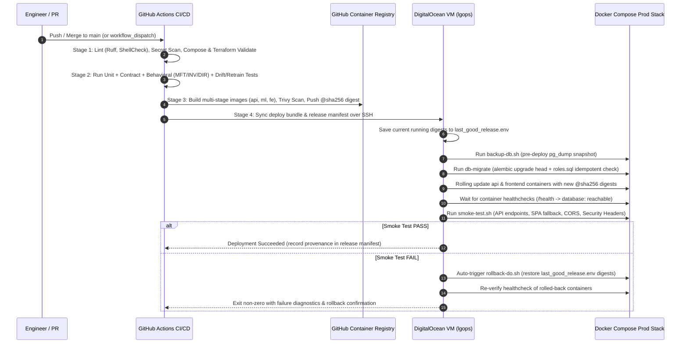
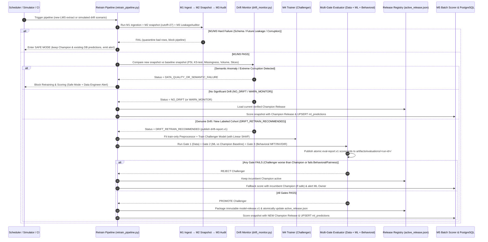

# Kiến trúc Đích trên DigitalOcean VM & Pipeline CI/CD (Production-Like Target Architecture v3)

> **Phiên bản:** 3.0 (2026-11-23)
> **Trạng thái:** Accepted (Thay thế kiến trúc Azure Container Apps v2 theo yêu cầu chuyển dịch sang **DigitalOcean Droplet VM**).
> **Tham chiếu ADR:** [ADR-0008](../adr/0008-cloud-migration-digitalocean-vm.md), [ADR-0009](../adr/0009-cicd-pipeline-digitalocean-ghcr.md), [ADR-0010](../adr/0010-drift-detection-and-continual-retraining-pipeline.md).

---

## 1. Mục tiêu Kiến trúc & Ràng buộc Vận hành

1. **Production-Like trên DigitalOcean Droplet VM:**
   - Triển khai toàn bộ hệ thống LearnGuard trên DigitalOcean Droplet (Ubuntu 24.04 LTS) nằm trong DigitalOcean VPC, được bảo vệ bởi Cloud Firewall + UFW + Fail2ban.
   - Phân tách mạng container thành 2 vùng cô lập:
     - `lg_frontend_net` (DMZ): chỉ chứa `nginx-frontend` và `backend-api`.
     - `lg_backend_net` (Private Data Plane): chứa `backend-api`, `postgres`, `ml-worker`, `ollama` (optional), `prometheus/cadvisor/node-exporter`. **PostgreSQL hoàn toàn không mở cổng ra Internet.**
2. **Bảo mật Dữ liệu & Least-Privilege ở Tầng Database:**
   - Duy trì phân tách 2 role PostgreSQL riêng biệt:
     - `lg_ml_writer`: chỉ có quyền ghi/upsert trên bảng `ml_predictions`.
     - `lg_api`: chỉ có quyền `SELECT` trên `ml_predictions` và quyền CRUD trên các bảng nghiệp vụ backend (`users`, `briefs`, `decisions`, `llm_calls`, `audit_logs`, `chat_sessions`, `chat_messages`).
3. **CI/CD Tự động Hóa Đầu-Cuối & Rollback Tức thì:**
   - Mọi thay đổi đi qua GitHub Actions: `Lint & Guardrails → 6-Layer Testing (Unit + Contract + Behavioral + Drift Simulation) → Build Immutable Docker Images → Trivy Scan → Push GHCR (@sha256 digest) → Deploy via SSH → DB Migration → E2E Smoke Test → Auto-Rollback on Failure`.
4. **Đóng Vòng lặp Telemetry, Phát hiện Drift & Continual Retraining:**
   - Chia sẻ volume bền vững `/opt/learnguard/data` (`oulad/` + `artifacts/`) giữa `ml-worker` (Read-Write) và `backend-api` (Read-Only) để cố vấn và quản trị viên theo dõi trực tiếp Scorecard đánh giá (`GET /evaluations`) và hành vi 4 tuần (`GET /predictions/.../activity`) trên giao diện web.

---

## 2. Sơ đồ Kiến trúc C4 — Container & Network Topology trên DigitalOcean

```mermaid
flowchart TB
    subgraph USERS["Người dùng & Dịch vụ Ngoài"]
        ADV["Advisor / Giảng viên (Browser)"]
        ADM["Admin / MLOps (Browser / SSH)"]
        GH["GitHub Actions CI/CD + GHCR"]
        OR["OpenRouter API (Primary LLM)"]
    end

    subgraph DO_CLOUD["DigitalOcean Cloud — VPC 10.116.0.0/20"]
        FW["DigitalOcean Cloud Firewall + UFW\n(Allow 80/443 Public; Allow 22 Operator/CI; Deny 5432/8000 Public)"]

        subgraph DROPLET["DigitalOcean Droplet VM (Ubuntu 24.04 LTS) — /opt/learnguard"]
            subgraph FE_NET["Docker Network: lg_frontend_net (DMZ)"]
                NGINX["Container: frontend (Nginx 1.27 + React SPA)\nPorts: 80/443 | TLS | Rate-Limit | Security Headers\n/ -> Static SPA | /api/* -> api:8000"]
            end

            subgraph BE_NET["Docker Network: lg_backend_net (Private Data Plane — internal: true)"]
                API["Container: api (FastAPI / Uvicorn)\nPort 8000 (internal only)\nRole: lg_api (SELECT ml_predictions, CRUD briefs/chat/audit)"]
                PG[("Container: postgres (PostgreSQL 16)\nPort 5432 (internal only)\nVolume: pg_data + daily pg_dump backups")]
                ML["Container: ml-worker (Batch Scoring + Drift & Retraining)\nTriggered by systemd timer / cron / CI\nRole: lg_ml_writer (UPSERT ml_predictions)"]
                OLLAMA["Container: ollama (Optional Local LLM Fallback)\nqwen2.5:3b | Port 11434 (internal)"]
                OBS["Observability Stack (Prometheus + Node Exporter + cAdvisor)\nInternal Metrics & Alerting"]
            end

            subgraph VOLUMES["Persistent Host Volumes (/opt/learnguard/data)"]
                V_OULAD[("oulad/ (7 Raw CSVs & Incoming Extracts)")]
                V_ART[("artifacts/\n- feature_snapshot_m2/\n- model-releases/ (active_release.json)\n- prediction-batches/\n- evaluations/ (eval-report.v1)\n- drift-reports/ (drift-report.v1)")]
                V_BAK[("backups/ (Encrypted/Compressed PG Dumps)")]
            end
        end
    end

    ADV -->|HTTPS 443| FW --> NGINX
    ADM -->|HTTPS 443 / SSH 22| FW
    GH -->|SSH Deploy + Pull @sha256| FW
    NGINX -->|Reverse Proxy /api/| API
    API -->|SQL (lg_api)| PG
    API -->|Fallback LLM| OLLAMA
    API -->|Primary LLM (HTTPS)| OR
    API -->|Read-Only Mount| V_ART
    API -->|Read-Only Mount| V_OULAD
    ML -->|Read/Write Mount| V_OULAD
    ML -->|Read/Write Mount| V_ART
    ML -->|SQL UPSERT (lg_ml_writer)| PG
    PG -->|pg_dump| V_BAK
    OBS -->|Scrape Metrics| API
    OBS -->|Scrape Metrics| PG
```

---

## 3. Luồng Triển khai CI/CD & Tự động Rollback (Sequence Diagram)



---

## 4. Luồng Phát hiện Data Drift, Chẩn đoán & Continual Retraining (Sequence Diagram)

Tuân thủ chặt chẽ nguyên tắc của **Lecture 4 (Q19–Q22)** và **Lecture 5–6**:
- Không tự động retrain mù quáng khi luồng dữ liệu bị lỗi schema hoặc lỗi ngữ nghĩa (semantic corruption).
- Chỉ promote mô hình Challenger khi vượt qua toàn bộ cổng kiểm định **Data Gate + ML Gate (Champion vs Challenger) + Behavioral Gate (MFT/INV/DIR)**.



---

## 5. Cấu trúc Thư mục Chuẩn trên DigitalOcean VM (`/opt/learnguard`)

```text
/opt/learnguard/
├── deploy/
│   ├── digitalocean/
│   │   ├── docker-compose.prod.yml
│   │   ├── .env                         # chmod 600 (KHÔNG commit)
│   │   ├── last_good_release.env        # tự động lưu trước mỗi lần deploy để rollback
│   │   ├── init-db.sh
│   │   └── prometheus.yml
│   ├── db/
│   │   ├── roles.sql
│   │   └── db_seed_full.sql
│   ├── ml/
│   │   ├── ml_pipeline.py
│   │   ├── drift_monitor.py
│   │   ├── behavioral_gate.py
│   │   ├── data_simulator.py
│   │   └── retrain_pipeline.py
│   └── releases/
│       └── prod.yaml                    # GitOps release manifest
├── scripts/
│   └── cd/
│       ├── deploy-do.sh
│       ├── smoke-test.sh
│       ├── rollback-do.sh
│       ├── backup-db.sh
│       └── restore-db.sh
└── data/
    ├── oulad/                           # 7 file CSV OULAD chuẩn
    ├── artifacts/
    │   ├── ingestion_m1/
    │   ├── feature_snapshot_m2/
    │   ├── preprocessing-runs/
    │   ├── model-runs/
    │   ├── model-releases/
    │   │   └── active_release.json      # Con trỏ release đang active + lịch sử rollback
    │   ├── prediction-batches/
    │   ├── evaluations/                 # Backend mount read-only phục vụ GET /evaluations
    │   └── drift-reports/               # Báo cáo chẩn đoán drift (drift-report.v1)
    └── backups/                         # Bản sao lưu PostgreSQL định kỳ & trước deploy
```
