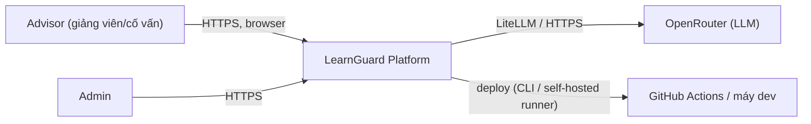
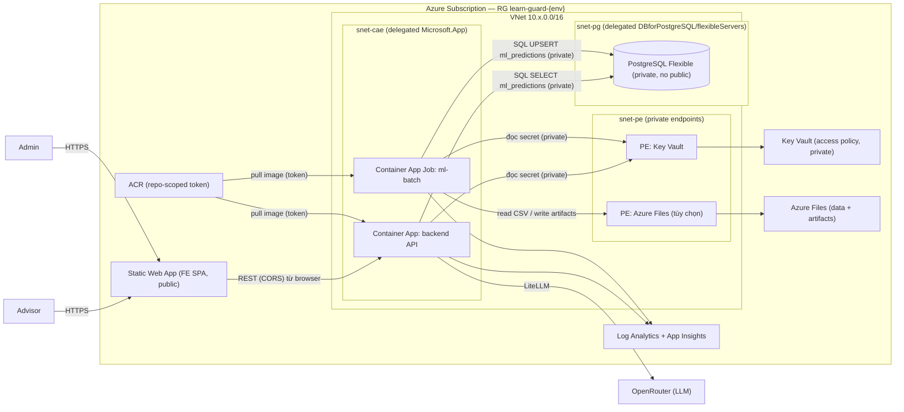
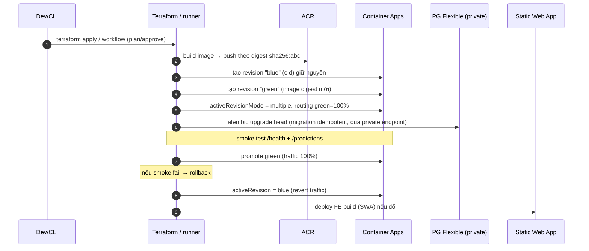
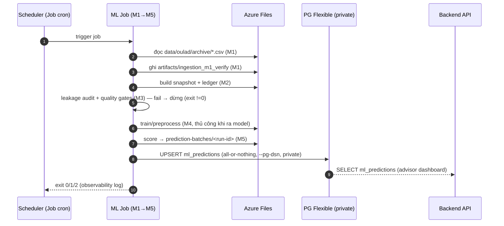

# LearnGuard — Target Architecture v2 (Proposed)

> File "kiến thức" → không commit. Trạng thái: **Proposed** — chờ người dùng duyệt.
> v1 (public) → **v2 (private networking, prod-like)**. Điều chỉnh theo kết quả xác minh quyền 2026-11-04: `Microsoft.Network/*` **có sẵn** (brief nói "KHÔNG Network" là sai). Điểm chặn thật còn lại: **role-assignment + ghi AAD**.

## 1. Mục tiêu & ràng buộc

- "Like production" tối đa trong giới hạn thực: **CÓ** `Microsoft.Network/*`; **KHÔNG** role-assignment (`Microsoft.Authorization/*/Write+Delete`); **KHÔNG** ghi AAD (không tự tạo service principal).
- Nguyên tắc phân lớp: **data plane private** (PG, Key Vault, tùy chọn ACR/Files), **app ingress public** (browser phải gọi được), **compute VNet-integrated** để outbound tới private endpoint.
- IaC = Terraform. Immutable image theo digest. Release manifest (gitops). Blue/green + rollback. Secret tập trung. Least-privilege ở data-plane. Observability. Prod có approval gate.

## 2. C4 — Level 1 (System Context)

## 3. C4 — Level 2 (Containers)

> Ghi chú: SWA là static host; API được gọi **trực tiếp từ browser** → API **vẫn cần public ingress** (không thể private hoàn toàn). "Private" áp dụng cho **dữ liệu** (PG/KV/Files), không áp dụng cho ingress của API. App Gateway là lựa chọn thay thế để "public frontend → private backend" nhưng bị hoãn (xem §6).

## 4. Thành phần Azure ↔ Terraform

| Thành phần | Azure resource | Ghi chú |
|---|---|---|
| Network | `azurerm_virtual_network` + `subnet` | 3 subnet: `snet-cae`, `snet-pg`, `snet-pe` |
| FE | `azurerm_static_web_app` | public endpoint, navigation fallback |
| Compute env | `azurerm_container_app_environment` | VNet-integrated (`infrastructure_subnet_id = snet-cae`) |
| API | `azurerm_container_app` | ingress **external** + IP restriction; outbound qua VNet |
| ML batch | `azurerm_container_app_job` | không ingress, VNet outbound |
| DB | `azurerm_postgresql_flexible_server` + delegated `subnet` (`snet-pg`) | `public_network_access_enabled=false`, TLS bắt buộc, 2 DB user |
| Files | `azurerm_storage_account` + `storage_share` + (tùy chọn) `private_endpoint` | mount qua account key/SAS |
| Secret | `azurerm_key_vault` + `private_endpoint` + access policy | access policy theo object-id (KHÔNG RBAC) |
| Image | `azurerm_container_registry` + token | repo-scoped token / admin user (public, vì private-endpoint ACR cần Premium) |
| Observability | `azurerm_log_analytics_workspace` + `azurerm_application_insights` | — |
| Private DNS | `azurerm_private_dns_zone` + `virtual_network_link` | `privatelink.postgres…`, `privatelink.vaultcore…`, `privatelink.file…` |
| CI identity | (không có trong IaC) | OIDC UAMI cần Admin → xem ADR-0006 |

## 5. Sequence diagrams

### 5.1 Deploy blue/green + rollback

### 5.2 Batch scoring (M1→M5)

## 6. Phản biện: điểm v2 còn NGẦM cần RBAC / quyết định mở

1. **CD cần identity có quyền trên RG.** Vì không tự tạo SP + không gán role, **OIDC/UAMI tự động vẫn cần Admin** (tạo identity + gán role + federated credential). Đường chính không cần Admin = **self-hosted runner tái dùng `az login`** (máy/VM đã đăng nhập chạy `terraform apply`) → vẫn full CI/CD. **Key Vault chỉ là nơi cất secret, không tạo ra quyền** (xem ADR-0006).
2. **API không auth (M6 chưa xong).** Dù có private data plane, API vẫn phải public (browser gọi) → endpoint `/predictions` **không xác thực** là gap lớn nhất. Private networking **không** fix được auth. → app-change-request (auth) hoặc chấp nhận rủi ro ghi rõ trong threat model.
3. **App Gateway (đã cân nhắc, hoãn).** App Gateway khả thi (có Network) để "public frontend → private backend", nhưng Standard_v2/WAF_v2 ~`$180–320/tháng` không scale-to-zero, và **vẫn không thay thế auth ứng dụng**. → Hoãn tới Phase 2; hiện dùng public ingress + IP restriction + CORS.
4. **ACR private endpoint cần Premium SKU** (đắt). → ACR giữ public + repo-scoped token (data-plane); private endpoint để dành nếu review yêu cầu.
5. **Private DNS + VNet link** là phần dễ sót khi Terraform: phải link zone vào VNet, không thì PG/KV private không resolve được từ CAE.
6. **Azure Files private endpoint** là tùy chọn; tối thiểu phải lock bằng storage firewall + key/SAS (không để `public_network_access` mở vô tội vạ).

**Kết luận phản biện:** v2 **prod-like ở data plane** (PG/KV private, CAE VNet-integrated) nhưng vẫn cần (a) **đúng 1** role-assignment nếu muốn CI tự động (do Admin làm); (b) bảo mật app yếu nhất vẫn ở **auth API chưa có** — không có hạ tầng nào bù được, phải ghi nhận rõ.

## 7. Open items → OPEN_QUESTIONS

- Q-AUTH: chấp nhận API không auth (mock) hay chờ backend M6 trước khi deploy prod?
- Q-CI-IDENTITY: chọn deploy tay (đường chính) hay yêu cầu Admin tạo UAMI + gán role cho OIDC?
- Q-RBAC: nếu đi OIDC, xác nhận Admin sẽ gán Contributor cho UAMI CI ở scope RG (ticket).
- Q-PRICE: SKU PG/CAE/SWA/ACR/VNet/PE cụ thể + chi phí ước lượng (P0.6).
- Q-POLICY: có thể còn Azure Policy deny assignment ở management group `FSO` chặn thêm — chưa xác minh.
