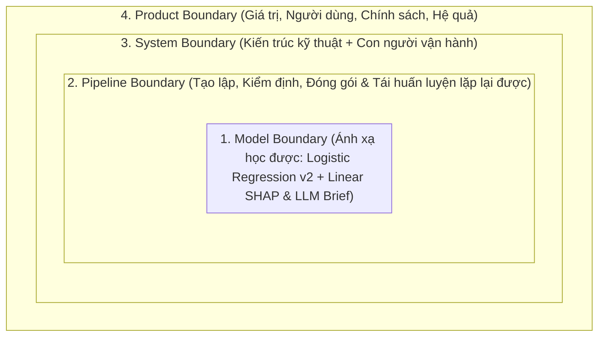

# Quy chuẩn Kỹ thuật Phần mềm, DevOps và MLOps (Production-Like Conventions)

> **Phiên bản:** 2.0 (2026-11-23)
> **Nền tảng lý thuyết:** Carnegie Mellon University — *Machine Learning in Production: From Models to Products* ([CMU MLIP Textbook](https://mlip-cmu.github.io/book/index.html)) & Bài giảng Học phần Lec 1–6 (VNU-UET).
> **Áp dụng cho:** Toàn bộ hệ thống **LearnGuard** (`learnguard-platform`, `BE-MLOPS`, `Data-ML-MLOPS`, `FE-MLOPS`).
> **Mục tiêu:** Thiết lập hệ thống quy chuẩn phát triển phần mềm, kiểm định chất lượng dữ liệu/mô hình, vận hành hạ tầng trên **DigitalOcean VM** và pipeline **CI/CD + Continual Retraining khi xảy ra Data Drift** đạt mức **like-production** cao nhất.

---

## 1. Triết lý Hệ thống AI trong Production (CMU MLIP Foundations)

Theo khung lý thuyết **CMU MLIP** (Ch. 1–7, Lec 1–2), mã nguồn huấn luyện mô hình ML chỉ chiếm một phần rất nhỏ trong toàn bộ hệ thống. Một mô hình có điểm số offline cao **không đồng nghĩa** với một sản phẩm an toàn hay hữu ích (`Accuracy ≠ Correctness ≠ Usefulness`).

### 1.1. Bốn Ranh giới Hệ thống (The Four Boundaries — Lec 1)

Mọi thiết kế, tài liệu, kiểm thử và pipeline CI/CD của LearnGuard được tổ chức xoay quanh 4 ranh giới lồng nhau:

| Ranh giới | Định nghĩa trong LearnGuard | Câu hỏi Kiểm định Bắt buộc |
| :--- | :--- | :--- |
| **1. Model** | Mô hình dự báo sớm rủi ro trượt/bỏ học (`LogisticRegression` + `LinearSHAP` tại `cutoff_day=27`) và dịch vụ tổng hợp `Advisor Brief` qua LLM (`LiteLLM` + `Ollama` fallback). | Độ chính xác trên từng slice? So với baseline? Độ trễ và chi phí suy luận? Điểm yếu của mô hình ở đâu? |
| **2. Pipeline** | Chuỗi `M1 (Ingest) → M2 (Snapshot) → M3 (Leakage/Quality Gate) → Drift Monitor → M4 (Preprocess/Train) → Evaluation Gates → Release → M5 (Batch Score)`. | Có tái lập (reproduce) được 100% từ hash không? Có tự động chặn/promote candidate không? Có truy vết (provenance) và rollback được không? |
| **3. System** | `PostgreSQL` (shared data plane) + `FastAPI Backend` + `React Advisor Dashboard` + `Nginx Reverse Proxy` + **Cố vấn học tập (Human-in-the-loop)**. | Điều gì xảy ra sau khi model xuất điểm rủi ro? Thành phần nào kiểm tra, trì hoãn (`manual_review`, `insufficient_data`), hoặc đảo ngược? Khi LLM/DB lỗi thì hệ thống phản ứng ra sao? |
| **4. Product** | Hỗ trợ giảng viên/cố vấn ưu tiên sinh viên cần can thiệp sớm ở cuối tuần 4 mà không gây quá tải cảnh báo và không phán xét nhân quả/tâm lý sinh viên. | Sản phẩm có giảm thời gian tổng hợp hồ sơ của cố vấn mà vẫn giữ 100% quyền quyết định ở con người không? Rủi ro dư thừa (residual risk) do ai sở hữu? |

---

## 2. Khung Yêu cầu `ASM ∧ SPEC => REQ` và Danh mục Thành công (Lec 2)

### 2.1. Phân tách Thế giới và Máy (`ASM ∧ SPEC => REQ`)

Phần mềm không thể tự mình thỏa mãn yêu cầu trong thế giới thực nếu các giả định về môi trường bị vi phạm (bài học *Lufthansa 2904* — Lec 2). Mọi tính năng và pipeline phải ghi rõ 3 thành phần:

1. **System Requirement (`REQ` — hiện tượng thế giới thực):**
   - `REQ-01 (Early Detection under Bounded Workload)`: Cố vấn học tập phát hiện và xem xét kịp thời các sinh viên có nguy cơ `Fail/Withdrawn` ngay sau tuần 4 (`day 27`) trong giới hạn ngân sách tải công việc tối đa 20% tổng số sinh viên đang theo học.
   - `REQ-02 (Grounded & Safe Advisory)`: 100% kế hoạch hỗ trợ sinh viên phải qua cố vấn phê duyệt (`accept`/`edit`/`reject`), dựa trên bằng chứng hành vi thực tế, không suy diễn nhân quả hoặc tâm lý, và không bị gián đoạn khi dịch vụ LLM bên ngoài gặp sự cố.
   - `REQ-03 (Drift Resilience)`: Khi phân bố dữ liệu học kỳ mới thay đổi, hệ thống phát hiện được sự dịch chuyển, phân biệt được lỗi dữ liệu với thay đổi phân bố thật, và chỉ cập nhật mô hình khi vượt qua toàn bộ cổng kiểm định.
2. **Environmental Assumptions (`ASM` — giả định môi trường cần giám sát):**
   - `ASM-01 (Temporal Availability)`: Dữ liệu LMS (`studentVle`, `studentAssessment`, `studentRegistration`) tính đến hết ngày 27 được đồng bộ đầy đủ trước thời điểm chạy batch đầu tuần 5.
   - `ASM-02 (Advisor Capacity)`: Đội ngũ cố vấn có đủ thời gian xử lý tối đa 20% danh sách sinh viên được gắn cờ (`target_alert_fraction = 0.20`).
   - `ASM-03 (Delayed Ground Truth)`: Nhãn kết quả thật (`final_result`) chỉ xuất hiện vào **cuối học kỳ**; do đó tại thời điểm tuần 4 của kỳ mới, cảnh báo drift **không có nhãn mới ngay lập tức** trừ khi có dữ liệu lịch sử của kỳ vừa kết thúc.
3. **Software Specifications (`SPEC` — đặc tả tại giao diện máy kiểm chứng được):**
   - `SPEC-01`: Pipeline `M3` chặn 100% bản ghi rò rỉ tương lai (`date > 27`) qua 3 lớp kiểm tra (ledger hash, row recomputation, 16 temporal injection probes).
   - `SPEC-02`: Ngưỡng cảnh báo production được khóa theo chính sách `validation_alert_budget_scalar_v1` (Top-20% trên tập validation), sai lệch thực tế `<= 1%`.
   - `SPEC-03`: Các bản ghi có `n_clicks_before_cutoff == 0` và `n_submitted_before_cutoff == 0` bắt buộc gán `status = insufficient_data` (`predicted_label = NULL`); các bản ghi có `uncertainty >= 0.80` bắt buộc gán `status = manual_review`.
   - `SPEC-04`: Khi LLM chính lỗi hoặc timeout (>30s), backend tự động chuyển sang Ollama local fallback hoặc mẫu `fallback_review`, tuyệt đối không trả HTTP 500 làm đứt luồng làm việc của cố vấn.

### 2.2. Danh mục Đo lường Thành công (Defensible Success Portfolio — Lec 2)

Không tối ưu một chỉ số đơn lẻ để tránh **Proxy Trap** (Lec 2 Slide 14–17):

| Thành phần Portfolio | Chỉ số đo lường (Metric) | Ngưỡng / Ràng buộc | Chủ sở hữu (Owner) |
| :--- | :--- | :--- | :--- |
| **Primary Outcome** | `Precision@Top20%` & `Recall@Top20%` trên sinh viên At-Risk tại ngày 27 | `Precision@20% >= 0.50` (fail `< 0.35`) | ML Owner & Product Lead |
| **Guardrails** | (1) Temporal Leakage Violations (2) Unreviewed Student Contact (3) LLM Uncited/Causal Claims | (1) `0 violations` (Hard Fail) (2) `0 auto-sends` (Hard Fail) (3) `Citation validity = 100%` | Data Engineer & Backend Owner |
| **Balancing Measures** | (1) Realized Advisor Alert Rate (2) Manual Review Queue Ratio (3) Brief Generation p95 Latency & Cost | (1) `20% ± 5%` (critical `> 30%`) (2) Theo dõi tỷ lệ `manual_review` (3) `p95 <= 15s`, token budget `<= 8000 in / 1000 out` | Platform / MLOps Engineer |
| **Leading Indicators** | Feature PSI, Missingness Rate, Week 3→4 Click Trend Shift | `PSI <= 0.10` (pass), `0.10–0.20` (warn), `> 0.20` (fail/triage) | Data / MLOps Engineer |
| **Model Diagnostics** | `ROC-AUC`, `PR-AUC`, `Brier Score`, `SHAP Additivity Error`, `Fairness Slice FNR Gap` | `ROC-AUC >= 0.70` (warn `< 0.75`), `SHAP error <= 1e-8`, `FNR gap <= 0.10` | ML Owner |

---

## 3. Ranh giới Kho mã nguồn (Repository Boundaries & Ownership)

Dự án tuân thủ mô hình **Multi-Repo với Platform Orchestrator tách biệt** (Conway's Law — Lec 3):

| Repository | Vai trò | Quyền trong Pipeline CI/CD & Platform | Hợp đồng Giao tiếp (Contract) |
| :--- | :--- | :--- | :--- |
| **`learnguard-platform`** | Hạ tầng (IaC), Dockerfiles, Compose, Nginx, Scripts, CI/CD, Drift/Retraining Orchestrator, Runbooks | **Đọc / Ghi toàn quyền** (Repo trung tâm điều phối) | Quản lý `deploy/releases/{dev,prod}.yaml`, `.github/workflows/`, `deploy/ml/` |
| **`ntk223/Data-ML-MLOPS`** | Core ML & Data package (`learnguard` CLI: M1–M5, Evaluation Gates) | **Upstream Read-Only** (Build image từ commit SHA cố định) | Xuất `prediction-batch.v1`, `model-release.v1`, `eval-report.v1` và ghi bảng `ml_predictions` qua role `lg_ml_writer` |
| **`ntk223/BE-MLOPS`** | FastAPI Modular Monolith (`learnguard_backend`: M6–M8, Briefs, Chat, Audit) | **Upstream Read-Only** (Build image từ commit SHA cố định) | Đọc bảng `ml_predictions` + `artifacts/evaluations` qua role `lg_api`; sở hữu `users`, `briefs`, `decisions`, `llm_calls`, `audit_logs`, `chat_*` |
| **`ntk223/FE-MLOPS`** | React 18 + TypeScript + Vite SPA (M9 Advisor Dashboard) | **Upstream Read-Only** (Build static bundle vào Nginx container) | Giao tiếp duy nhất qua REST API theo `FE-MLOPS/docs/API_CONTRACT.md` |

> [!IMPORTANT]
> **Quy tắc Bất biến (Hard Rule):**
> 1. Không import mã Python nội bộ giữa `Data-ML-MLOPS` và `BE-MLOPS`. Hai thành phần chỉ giao tiếp qua bảng `ml_predictions` (PostgreSQL) và thư mục artifact chuẩn hóa (`eval-report.v1`).
> 2. Mọi logic mở rộng phục vụ vận hành production (Drift Triage, Data Simulator, Behavioral Gate, Continual Retraining Orchestrator, Dockerfiles, Nginx config, DB init/backup) được đặt tại `learnguard-platform/deploy/` và `learnguard-platform/scripts/`.

---

## 4. Quy chuẩn Kỹ thuật Phần mềm (Software Engineering Conventions)

### 4.1. Quản lý Phiên bản & Git Workflow
1. **Nhánh (Branching Strategy):**
   - `main`: Nhánh production/release luôn ở trạng thái deploy được (protected branch).
   - Nhánh phát triển: `feat/<scope>-<topic>`, `fix/<scope>-<topic>`, `ops/<scope>-<topic>`, `docs/<scope>-<topic>`.
2. **Chuẩn Commit (Conventional Commits):**
   - Cú pháp: `<type>(<scope>): <imperative summary in English>`
   - Ví dụ:
     - `feat(mlops): add drift triage and champion-challenger retraining pipeline`
     - `feat(cicd): add digitalocean production deployment workflow with auto-rollback`
     - `docs(adr): record migration to digitalocean droplet architecture`
   - Tuyệt đối không commit `.env`, SSH private keys, database dumps, hoặc `.terraform/`.
3. **Ngôn ngữ Tài liệu & Mã nguồn:**
   - **Tài liệu (`docs/`, `runbooks/`):** Tiếng Việt chuẩn xác, giữ nguyên thuật ngữ chuyên ngành tiếng Anh (`covariate shift`, `point-in-time correctness`, `immutable digest`, `blue-green deployment`, `abstention`).
   - **Mã nguồn (Python, Bash, Terraform, YAML, SQL, Dockerfile):** Tiếng Anh 100%, tuân thủ type annotations (`from __future__ import annotations`), docstring rõ ràng.

### 4.2. Chất lượng Mã nguồn, Bảo mật & Tính Tái lập (Reproducibility)
1. **Python Standards:**
   - Python `>= 3.11` (chuẩn hóa `python:3.12-slim` trên toàn bộ container).
   - Linter & Formatter: `ruff check` (không lỗi unused imports, lỗi cú pháp, hay lỗ hổng subprocess).
   - Determinism: Cố định `random_state = 42`, `threadpool_limits(limits=1)` khi huấn luyện, sắp xếp khóa composite `(code_module, code_presentation, id_student)` bằng `mergesort` trước khi băm hoặc lấy mẫu.
2. **Shell Script Standards:**
   - Mọi script `.sh` bắt buộc mở đầu bằng `#!/usr/bin/env bash` và `set -euo pipefail`.
   - Thiết kế **Idempotent** (chạy lặp lại nhiều lần không gây lỗi trạng thái).
   - Không bao giờ in secret (`DATABASE_URL`, `LLM_API_KEY`, `PGPASSWORD`, SSH key) ra stdout/logs; tắt `set -x` ở mọi khối lệnh xử lý biến nhạy cảm.
3. **Container & Supply Chain Standards:**
   - Multi-stage build giảm kích thước image và bề mặt tấn công.
   - Chạy tiến trình ứng dụng bằng **non-root user** (`learnguard` UID 10001).
   - Mọi service trong `docker-compose.prod.yml` bắt buộc khai báo `healthcheck`, `restart: unless-stopped`, giới hạn tài nguyên (`mem_limit`, `cpus`) và phân tách mạng (`lg_frontend_net` vs `lg_backend_net`).
   - Ghim phiên bản image theo **immutable digest** (`@sha256:...`) hoặc release tag gắn liền với commit SHA trong `deploy/releases/prod.yaml`.

---

## 5. Hợp đồng Dữ liệu & Kiểm soát Ba Điểm (Data Contracts & Three Control Points — Lec 1, Lec 4)

### 5.1. Hợp đồng Dữ liệu 6 Điều khoản (6-Clause Data Contract — Lec 4 Q15–Q16)

Một schema tĩnh chỉ kiểm tra được tên cột và kiểu dữ liệu. LearnGuard áp dụng **Data Contract 6 điều khoản** tại ranh giới `M1 → M2 → M3 → M5 → DB`:

| Điều khoản | Nội dung Cam kết | Cơ chế Kiểm chứng Tự động | Hành động khi Vi phạm |
| :--- | :--- | :--- | :--- |
| **1. Schema & Types** | Đủ 7 bảng OULAD đầu vào và 21 cột `snapshot.parquet`; `label ∈ {0, 1}`; PK composite duy nhất. | `M1 SchemaValidator` & `M3 Gate 1 (snapshot_schema, duplicate_keys)` | Cách ly dòng lỗi vào `quarantine/`; nếu lệch cấu trúc snapshot → Hard Fail (exit 1). |
| **2. Semantic & Unit Invariants** | `sum_click > 0`, `score ∈ [0, 100]`, `date` là số ngày tính từ ngày khai giảng học phần, tỷ lệ thay đổi quy mô không vượt ngưỡng vật lý. | `M1 Quarantine Rules` + `DriftMonitor Semantic Anomaly Check` | Chặn pipeline, kích hoạt cảnh báo `DATA_QUALITY_OR_SEMANTIC_FAILURE`, cấm retrain. |
| **3. Point-in-Time Temporal Cutoff** | Chỉ sử dụng sự kiện `date <= 27`; loại trừ sinh viên đã rút học (`date_unregistration <= 27`) khỏi tập dự báo tương lai. | `M3 LeakageAuditor` (ledger hash + row recompute + 16 future-event injection probes) | Hard Fail ngay lập tức (`future_event_leak`), giữ nguyên dự đoán cũ trong DB. |
| **4. Completeness & Missingness Semantics** | Phân biệt rõ "không tương tác" (`clicks = 0`) với "thiếu dữ liệu đánh giá" (`avg_score_submitted IS NULL`) và "không đủ dữ liệu dự báo" (`insufficient_data = True`). | `M3 Gate 2 (missing_rate)` (warn `> 30%`, fail `> 60%`) | Không bao giờ `fillna` mù ở tầng dữ liệu; chuyển sinh viên thiếu dữ liệu sang `status = insufficient_data`. |
| **5. Distribution & Volume Stability** | Tỷ lệ kích thước dữ liệu `volume_ratio ∈ [0.10, 10.0]`; độ lệch phân bố từng đặc trưng `PSI <= 0.20` (với cỡ mẫu `>= 200`). | `M3 Gate 3 & 4` + `DriftMonitor` (PSI, KS-test, Slice PSI) | Phân loại tự động: `NO_DRIFT` / `WARN_MONITOR` / `DRIFT_RETRAIN_RECOMMENDED` / `QUARANTINE`. |
| **6. Provenance & Acceptable Use** | Mọi snapshot gắn `snapshot_version` và `snapshot.ledger.json`; mọi dự đoán ẩn danh qua `student_key` 16-hex; chỉ phục vụ cố vấn hỗ trợ học tập. | `verify-preprocessor`, `verify-model`, `verify-release`, `SQLAuditLogRepository` | Từ chối nạp model nếu lệch `snapshot_version` hoặc SHA-256; ghi vết mọi truy cập vào `audit_logs`. |

### 5.2. Kiến trúc Phòng vệ Ba Lớp (Three Control Points — Lec 1 Slide 50–51)

1. **Trước Suy luận (Before Inference):**
   - Kiểm định schema, cách ly dữ liệu bẩn (`quarantine/`), kiểm toán chống rò rỉ thời gian (`LeakageAuditor`), kiểm tra giới hạn token đầu vào LLM (`LLM_MAX_INPUT_TOKENS = 8000`) và lọc bỏ hoàn toàn PII trước khi tạo prompt.
2. **Xung quanh Quyết định / Hành động (Around Decision & Action):**
   - Chính sách **Abstention & Escalation**: tự động chuyển sang `insufficient_data` (khi không có click và không có bài nộp) hoặc `manual_review` (khi `uncertainty >= 0.80`).
   - Kiểm tra cấu trúc JSON và trích dẫn bằng chứng (`evidence_features`) của LLM Advisor Brief; tự động chuyển sang `fallback_review` khi LLM lỗi.
   - Bắt buộc **100% Human Oversight**: cố vấn phải xem xét, chỉnh sửa hoặc phê duyệt (`accepted` / `rejected`), hệ thống không có bất kỳ luồng tự động gửi thông báo nào tới sinh viên.
3. **Sau Triển khai (After Deployment):**
   - Ghi nhận telemetry đầy đủ (`llm_calls` lưu latency/tokens/cost; `audit_logs` lưu hành động; `release.provenance.json` theo dõi `realized_alert_rate`).
   - Giám sát Data Drift & Alert-Rate Drift định kỳ; hỗ trợ rollback 1 lệnh cho cả Container Release lẫn Model Release.

---

## 6. Tháp Kiểm thử 6 Tầng cho Hệ thống AI (6-Layer AI System Testing Pyramid — Lec 5 & Lec 6)

Để ngăn chặn hiện tượng **"Green components, red system"** và **"Silent success"** (Lec 6 Slide 2–4), pipeline CI/CD bắt buộc thực thi 6 tầng kiểm thử:

| Tầng | Tên Tầng Kiểm thử | Phạm vi & Kỹ thuật | Tiêu chí Hard-Fail (Chặn Release/Deploy) |
| :--- | :--- | :--- | :--- |
| **L1** | **Unit & Determinism Tests** | Kiểm thử hàm đơn vị trong `Data-ML-MLOPS`, `BE-MLOPS`, `FE-MLOPS` (`tsc --noEmit && vite build`). | Bất kỳ unit test hoặc type-check nào thất bại. |
| **L2** | **Semantic & Boundary Contract Tests** | Kiểm chứng hợp đồng giữa các thành phần: công thức `student_key` test vectors, schema 15 cột `prediction-batch.v1`, 4 giá trị `status`, schema `eval-report.v1`. | Lệch test vector `student_key`, thiếu cột bắt buộc, hoặc silent NaN/null trong output. |
| **L3** | **Model Behavioral Testing (Lec 5)** | (1) **MFT**: Hồ sơ sinh viên rủi ro cực cao vs tích cực cực cao. (2) **Invariance**: Hoán vị thứ tự dòng không đổi điểm rủi ro. (3) **Directional**: Giảm số click hoặc giảm điểm trung bình không được làm giảm xác suất rủi ro. (4) **SHAP Additivity** & **Fairness Slices**. | Vi phạm tính đơn điệu (Directional), sai số SHAP `> 1e-8`, hoặc `ROC-AUC < 0.70`. |
| **L4** | **Drift & Retraining Pipeline Integration Tests** | Mô phỏng dữ liệu mới & drift (`data_simulator.py`) → Chẩn đoán (`drift_monitor.py`) → Tái huấn luyện (`retrain_pipeline.py`) → So sánh Champion vs Challenger. | Pipeline tự động retrain trên dữ liệu lỗi ngữ nghĩa (vi phạm Lec 4 Q20) hoặc promote model kém hơn Champion. |
| **L5** | **Safeguard & Fault-Injection Recovery Tests (Lec 6)** | Kiểm thử cơ chế dự phòng khi LLM không khả dụng (`fallback_review`), dữ liệu thiếu (`insufficient_data`), độ không chắc chắn cao (`manual_review`), hoặc DB lỗi (`503`). | Hệ thống crash (HTTP 500), làm lộ secret trong log, hoặc đưa ra dự đoán sai khi thiếu dữ liệu. |
| **L6** | **Post-Deploy Smoke & Rollback Verification** | Kiểm thử E2E sau khi deploy lên DigitalOcean VM (`/health`, `/predictions`, `/evaluations`, `/audit-logs`, SPA routing). | Healthcheck hoặc smoke test thất bại → Tự động kích hoạt `rollback-do.sh`. |
